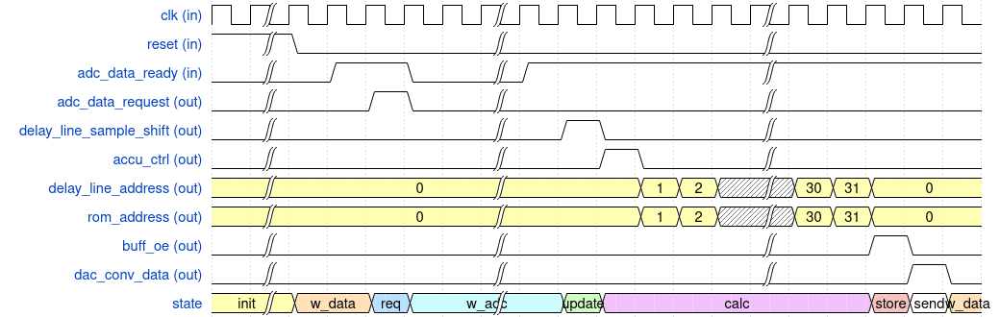
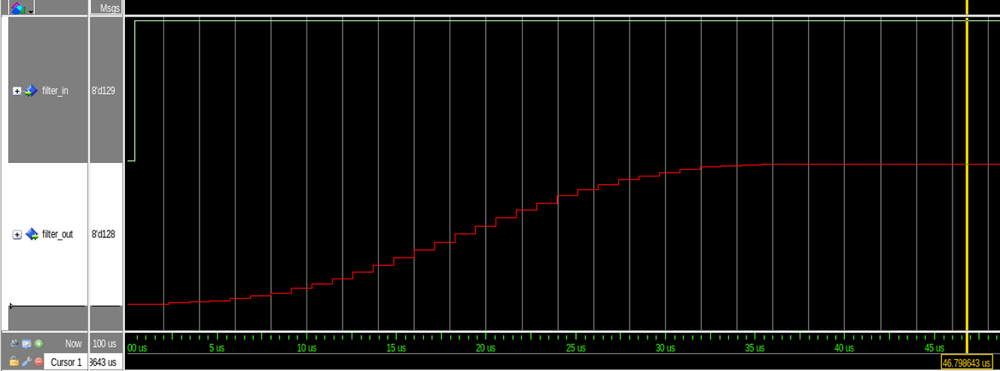

# fir-filter-vhdl

A 32-tap FIR digital filter in VHDL, from RTL simulation through logic synthesis for a standard-cell library to an FPGA implementation driving an ADC and a DAC.

Pair project, February to April 2025 (the course's third step, FPGA implementation, was the one carried out), from a university course on integrated digital electronics design. This repository keeps only the design sources, the testbenches, the constraints, the tool reports and two figures; it leaves out the generated tool files, the cell libraries and the course material.

## The design

The filter reads 8-bit samples from an analog-to-digital converter, keeps the last 32 in a delay line, and for each new sample computes the sum of 32 products with a coefficient ROM, then writes the 8-bit result to a digital-to-analog converter.

| Block (`vhd/`) | Role |
|---|---|
| `adc_interface` | state machine that drives the ADC (start conversion, wait for end of conversion, read) and hands over a sample; states `init, wait_data_request, convst, eoc_wait, rd, rd_wr` |
| `dac_interface` | state machine that writes the result to the DAC; states `init, send` |
| `delay_line` | storage of the last 32 input samples, addressed by the control state machine |
| `rom` | the 32 symmetric 8-bit filter coefficients (supplied by the course) |
| `mult` | 8-bit by 8-bit multiplier |
| `accu` | 21-bit accumulator |
| `buff` | output register |
| `register_1` | 8-bit register that captures the ADC sample when the ADC interface says the conversion data is valid |
| `fsm` | main control state machine; states `init, wait_data, req_data, wait_adc, update_delay_line, calcul, store_res, send_data`, with a 5-bit counter from 0 to 31 that steps through the 32 taps |
| `filter` | top level that connects all blocks |

My part of the pair was the specification, implementation and validation of the two state machines, `adc_interface` and `fsm`, with their timing diagram above. The other blocks were written within the pair; the coefficient table came with the course.

Compile order (ModelSim): `accu, buff, delay_line, fsm, mult, dac_interface, adc_interface, register_1, rom, filter`, then the testbenches.

## Testbenches (`bench/`)

- `bench.vhd`: drives the filter with a step and an impulse, with a process that checks the ADC conversion timing. The assertion on the impulse response was never completed.
- `bench_sinus.vhd`: feeds a quantised 8-bit sine.
- `bench_sinus_var.vhd`: the same, with a frequency that is increased step by step, to follow the filter's response.

## Results (from the tool reports in this repository)

**Logic synthesis** with Synopsys Design Vision, `c35` standard-cell library, clock 50 MHz (20 ns), three operating corners (`synth/reports/`):

| Corner | Cell area (µm²) | Timing slack at 50 MHz (ns) | Total dynamic power (mW) |
|---|---|---|---|
| worst | 177,468 | 0.00 (met) | 5.51 |
| typical | 172,136 | 4.94 (met) | 5.53 |
| best | 172,190 | 12.15 (met) | 5.60 |

For the typical corner the area is 67,012 µm² of combinational cells, 105,123 µm² of registers and 29,106 µm² of interconnect, about 201,242 µm² in total. Cell leakage is 1.4 nW in each corner.

**FPGA** (Xilinx ISE 14.7, Spartan-3 `xc3s1000`, package `ft256`, speed grade -5; `fpga/reports/`): 89 flip-flops, 116 four-input LUTs, 95 occupied slices (1 % of the device), 26 of 173 I/O pins, one 18x18 multiplier and one global clock buffer. Placement and routing completed. **The run had no timing constraint** (the timing report says "No timing constraints found"), so it shows resource use, not a guaranteed clock frequency. Pin assignments for the development board are in `fpga/filtre.ucf`.

## What this repository does not show

- I did not re-run the simulations, the synthesis or the FPGA flow for this repository: the tools (ModelSim, Design Vision, ISE) are not available to me. The numbers above are copied from the reports the tools produced during the project.
- The ASIC place-and-route step of the course (with Cadence Innovus) was not done.
- There is no automated pass/fail regression: the testbenches are checked by looking at waveforms, and `bench.vhd` still contains an unfinished assertion for the impulse response.

## Licence

No licence file: this is a pair project built on course material, so no licence is granted here. Please contact me before reusing the design.
